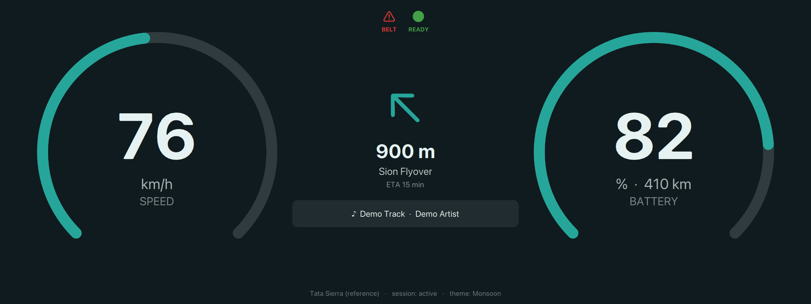

# Car2Phone

**An open protocol that lets a phone drive every display in a car — while the carmaker keeps control of the safety layer and its brand.**

Android Auto and Apple CarPlay give the phone one window on one screen. CarPlay Ultra takes over every screen, but on Apple's terms. Car2Phone is the open, OEM-controlled alternative:

| Display | What the phone sends | Who renders it |
|---|---|---|
| Driver cluster | **Themes + data cards** (navigation, media) | The **car**, locally. Tell-tales and gauges never depend on the phone. |
| Center screen | Video stream (apps, maps) + cards | Phone (video) inside the OEM's frame |
| Passenger / rear screens | Video stream | Phone |

If the phone disappears, the car falls back to its own defaults within one second. That rule is enforced in the core library, not left to each integration.



## India first

India is the launch market (see [the cockpit research report](reports/Indian%20car%20cockpit%20OS%20suppliers.md)). The commercial proof points we are working toward:

1. **One store listing — Harman Ignite.** Harman's AAOS-compliant Ignite Store powers Tata's Arcade.ev; one listing reaches most Tata cars.
2. **Two OEM cluster-theme integrations:**
   - **Mahindra** — INGLO EVs (BE 6, XEV 9e, XEV 9S): Android Automotive on Snapdragon SA8295P, three 12.3" screens.
   - **Maruti Suzuki** — e Vitara: **Automotive Grade Linux + Qt** for cluster and infotainment. Suzuki chose Qt on Linux to avoid vendor lock-in; our portable core targets that stack **from day one**, not as a later port.
3. **Tata Motors** — Harrier.ev and Sierra (three screens), via Harman Ignite / Ready Link and Tata's T.idal software layer.

Details: [docs/roadmap.md](docs/roadmap.md) and [docs/integrations/](docs/integrations/).

## Repository layout

```
core/                 Portable C++17 library (Linux/AGL, QNX, Android NDK, macOS). No dependencies.
  include/c2p/        Public headers (protocol, session, safety policy, OEM profiles, transport)
  src/                Implementation
  tests/              Unit tests (no framework needed)
  tools/              Headless car + phone simulators (CLI)
car/qt-cluster/       Qt/QML cluster-theme receiver — the AGL (Maruti e Vitara) target, also runs on desktop
  agl/                Yocto/AGL recipe template
car/aaos-receiver/    Android Automotive receiver skeleton — Harman Ignite (Tata) / Mahindra INGLO target
phone/android/        Phone app skeleton (virtual displays + encoder)
profiles/             Reference display layouts for Indian cars (unofficial, from public specs)
docs/                 Protocol spec, architecture, roadmap, OEM integration notes
reports/              Market and supplier research
```

## Quick start (macOS or Linux)

```bash
make test
```

```bash
make sims
```

Then in two terminals — a headless car using the Mahindra INGLO layout, and a phone that connects and pushes a theme and navigation cards:

```bash
./build/c2p_car_sim profiles/mahindra-inglo.ini
```

```bash
./build/c2p_phone_sim 127.0.0.1 midnight
```

Try `saffron` instead of `midnight` to see the safety policy reject a theme whose accent colour is too close to the amber reserved for warning lights.

The Qt cluster (needs Qt 5.15 or Qt 6 with Qt Quick; pass `QMAKE=/path/to/qmake` if `qmake` is not on your PATH). Run it, then point `c2p_phone_sim` at `127.0.0.1`:

```bash
make cluster && ./build/qt-cluster/car2phone-cluster profiles/maruti-e-vitara.ini
```

## Status

Pre-alpha scaffold, protocol v0. Built and tested: core library, simulators, Qt cluster. Not yet built: Android phone app, AAOS receiver (no Android SDK in the bootstrap environment). Video streaming is specified but not implemented.

## Naming and trademarks

Car2Phone is not affiliated with Google, Apple, Harman or any carmaker. Profiles describe display layouts from public specifications and are not endorsed by the OEMs. "Android Auto", "CarPlay" and OEM names are trademarks of their owners.

## License

[Apache-2.0](LICENSE), chosen for its patent grant, which OEMs and tier-1s generally require. Source files carry SPDX headers.
