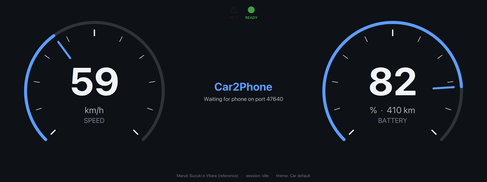
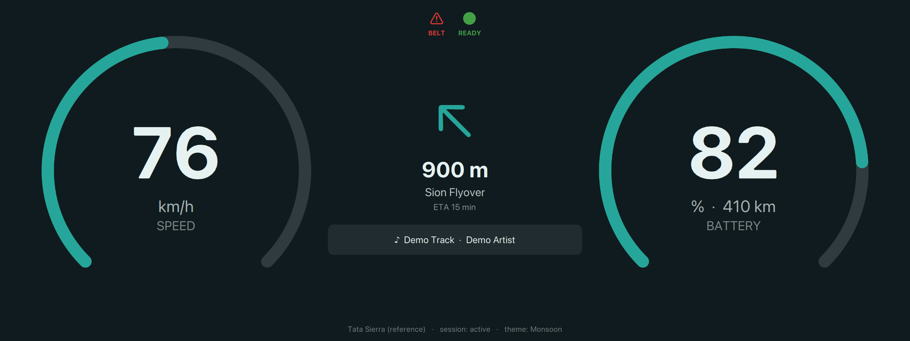
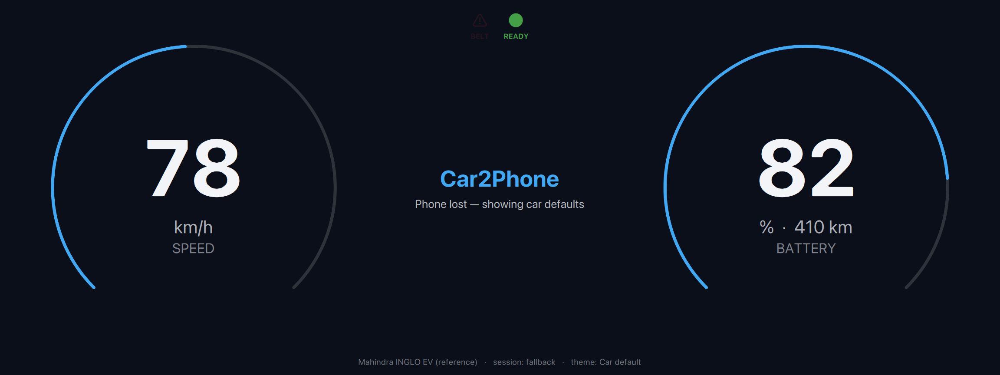

# Qt cluster receiver (AGL target)

The car-side receiver for Qt/QML cockpits, in particular **Maruti Suzuki's e Vitara (Automotive Grade Linux + Qt)**. It also runs on a desktop, which makes it the simulator for demos.

| Default (car theme, waiting) | Phone theme + cards (Tata Sierra layout) | Phone lost → car defaults (Mahindra INGLO) |
|---|---|---|
|  |  |  |

## Build and run

Desktop (Qt 5.15 or Qt 6), from the repository root:

```bash
make cluster
```

```bash
./build/qt-cluster/car2phone-cluster profiles/maruti-e-vitara.ini
```

```bash
./build/c2p_phone_sim 127.0.0.1 marine
```

CMake (Qt 6; this is what AGL/Yocto uses):

```bash
cmake -S car/qt-cluster -B build/cluster-cmake && cmake --build build/cluster-cmake
```

AGL: see the recipe template in [agl/car2phone-cluster_git.bb](agl/car2phone-cluster_git.bb).

Automated screenshot (used for visual checks):

```bash
./build/qt-cluster/car2phone-cluster profiles/maruti-e-vitara.ini --screenshot out.png --after 2000
```

## Integration seam for an OEM HMI

`src/clusterbridge.h` is the part an OEM keeps; `qml/` is a reference only.

| Property group | Source | Phone can change it? |
|---|---|---|
| `speed`, `stateOfCharge`, `rangeKm`, tell-tales | Car signals (simulated here) | **No** |
| `background`, `foreground`, `accent`, `gaugeStyle`, `themeName` | Phone theme, validated by the core | Yes, within the safety policy |
| `nav*`, `media*` | Phone cards | Yes, data only — the car renders them |
| `sessionState`, `stateReason` | Core session | — |

To use your own HMI: register `ClusterBridge` as a context property (as `main.cpp` does), bind your QML to its properties, and feed your real vehicle signals into `CarHost::publishSignal` in place of `stepVehicle()`.

## Notes

- Qt 5.15 on current macOS SDKs: the `.pro` file drops Apple's deprecated AGL (Apple GL) framework from the link line.
- `QT_QPA_PLATFORM=offscreen` does not render Qt Quick with Qt 5.15 on macOS, so `--screenshot` needs a normal window there. On Linux use `xvfb-run` or `QT_QPA_PLATFORM=offscreen`.
